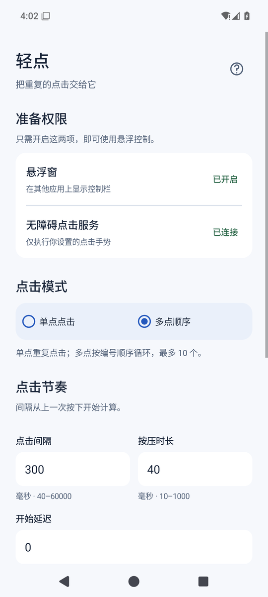
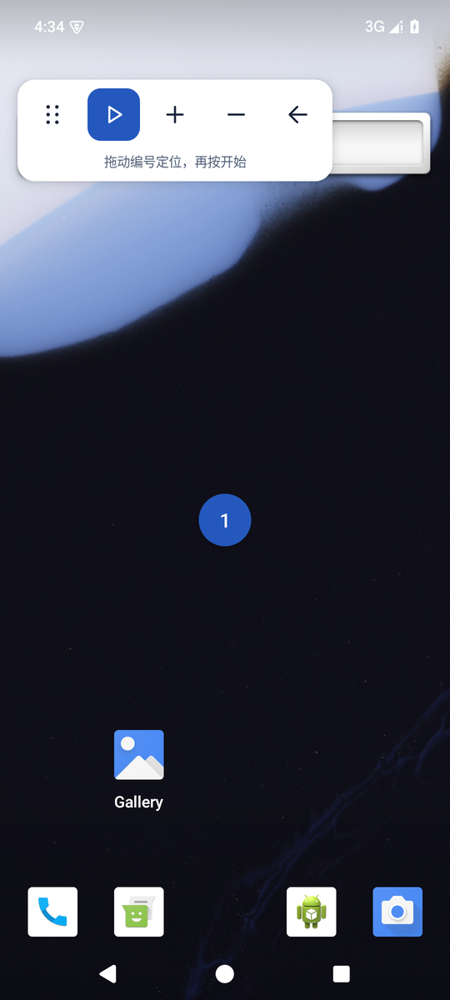
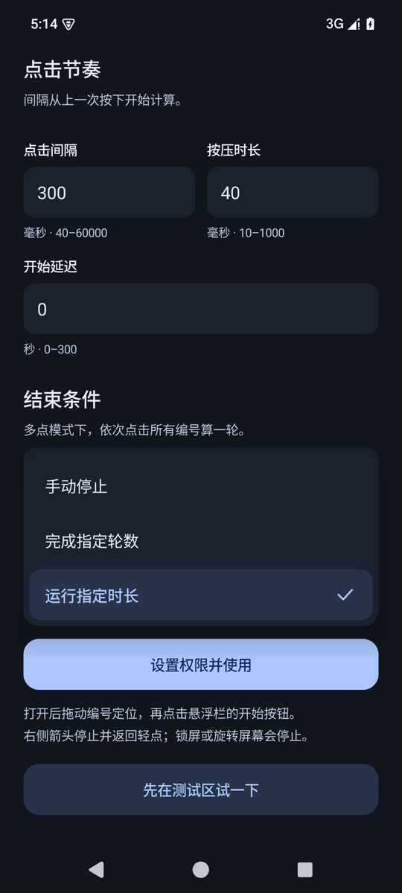
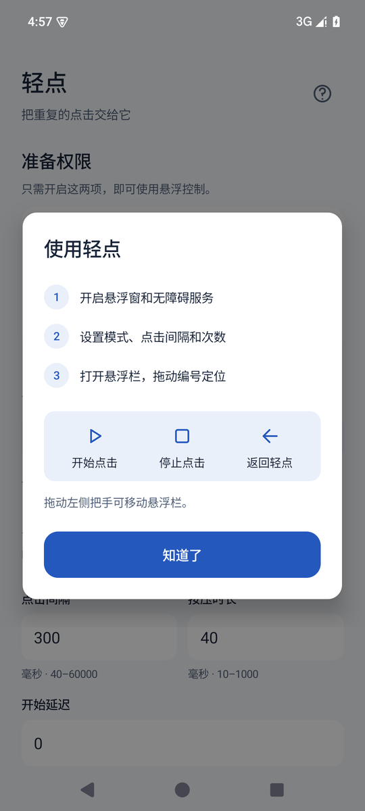

# 轻点 · LightTap

一个轻量的 Android 连点器：设置点击位置、节奏和结束条件，通过悬浮栏手动开始或停止。

采用 **Java + Android 原生 Views**，支持 **Android 8.0 及以上**。无运行时第三方依赖，无广告、账号和统计组件，不申请网络权限，无需 root。

**[下载最新版 APK](https://github.com/Nagnip-xu/LightTap/releases/latest)** · [更新记录](CHANGELOG.md) · [验证记录](TESTING.md) · [反馈问题](https://github.com/Nagnip-xu/LightTap/issues)

## 界面预览

| 主界面 | 悬浮控制 | 深色主题与结束条件 |
| :---: | :---: | :---: |
|  |  |  |

以上均为 Android 15 模拟器的实际截图，部分截图展示测试时的参数；首次安装的默认参数见下表。

## 能做什么

- **单点或多点点击**：单点重复，或最多 10 个目标按编号循环。
- **自定义点击节奏**：调整点击间隔、按压时长和开始延迟。
- **三种结束条件**：手动停止、完成指定轮数、运行指定时长。
- **悬浮控制**：拖动工具栏与编号目标，随时开始、停止或返回设置。
- **本地点击测试**：先在应用的测试区核对位置和收到的点击次数。
- **本地保存与主题适配**：保存参数和目标位置，跟随系统浅深色，支持大字体与滚动查看。

## 下载与安装

1. 打开 [发布页面](https://github.com/Nagnip-xu/LightTap/releases/latest)，下载 `LightTap-1.0.4.apk`。
2. 将 APK 安装到 Android 8.0 或更高版本的手机，打开“轻点”。
3. 按应用中的引导开启悬浮窗和无障碍点击服务。

也可以从仓库下载 [APK](delivery/LightTap-1.0.4.apk)、[SHA-256 校验文件](delivery/SHA256.txt) 和 [校验信息](delivery/校验信息.txt)。当前发行包为 **41,775 字节，约 41 KB**。

使用相同发行签名的旧版可直接覆盖安装，保留配置和位置。自行构建的 APK 使用你本机的签名，不能直接覆盖本仓库提供的发行包。

在 PowerShell 中核对安装包完整性：

```powershell
Get-FileHash .\LightTap-1.0.4.apk -Algorithm SHA256
```

将结果与下载的 `SHA256.txt` 对照。校验值用于确认文件一致性。

## 三步开始使用

1. **开启权限**：在首页分别开启“悬浮窗”和“无障碍点击服务”，返回后确认显示“已开启”“已连接”。首次使用会说明服务用途，需要主动同意。
2. **配置参数**：选择单点或多点，设置间隔、按压时长、开始延迟和结束条件。建议先进入“先在测试区试一下”确认效果。
3. **定位并开始**：点击“打开悬浮控制”，切换到目标应用，拖动编号到点击位置，再按悬浮栏中的三角形开始。

<details>
<summary>查看应用内的简短使用指南</summary>



</details>

### 悬浮栏按钮

| 按钮 | 作用 |
| --- | --- |
| 左侧点状把手 | 拖动整个悬浮栏 |
| 三角形 / 方形 | 开始点击 / 停止点击 |
| 加号 | 多点模式下添加目标，最多 10 个 |
| 减号 | 多点模式下删除最后一个目标，至少保留 1 个 |
| 右侧返回箭头 | 停止点击、收起悬浮栏和编号，并返回轻点设置页 |

拖动编号圆点即可改变点击位置；长按工具栏按钮可查看用途。点击目标不能与控制栏重叠。倒计时与点击过程中会隐藏编号，停止后恢复显示。

### 可调参数

| 参数 | 范围 | 默认值 |
| --- | --- | --- |
| 点击模式 | 单点重复 / 多点按编号循环；多点模式也可只保留 1 个目标 | 单点 |
| 点击间隔 | 40–60,000 毫秒，从上一次按下到下一次按下 | 300 毫秒 |
| 按压时长 | 10–1,000 毫秒 | 40 毫秒 |
| 开始延迟 | 0–300 秒，每次重新开始都会生效 | 3 秒 |
| 结束条件 | 手动停止 / 完成指定轮数 / 运行指定时长 | 完成指定轮数 |
| 循环轮数 | 1–1,000,000 轮 | 100 轮 |
| 运行时长 | 1–86,400 秒，不包含开始延迟 | 60 秒，选择按时长结束后生效 |

点击间隔至少要比按压时长多 **20 毫秒**。实际频率受 Android 手势调度影响。

**一轮怎么算？** 单点模式每次点击算一轮；多点模式依次点击全部编号算一轮。例如设置 3 个目标、5 轮，正常完成时共点击 15 次。

## 权限与隐私

| 权限或能力 | 用途 |
| --- | --- |
| 悬浮窗 `SYSTEM_ALERT_WINDOW` | 在其他应用上显示控制栏和编号目标 |
| 无障碍服务的手势能力 | 按指定坐标、时长和顺序执行点击 |

无障碍服务不申请读取窗口内容或按键过滤，不订阅界面事件。应用不申请网络、存储、通讯录等权限；配置和坐标仅保存在应用私有数据中，卸载或清除数据会重置。

只有你主动按下开始按钮后才会点击。应用不开机自启，不在停止后自动恢复执行；锁屏、屏幕旋转或配置变化、返回设置、无障碍中断、手势失败或超时都会停止。悬浮权限失效会关闭悬浮栏。已开始的按压最多在 1 秒内结束。

## 常见问题

### Android 13 及以上无法开启无障碍？

侧载应用可能遇到系统“受限设置”。确认安装来源和权限用途后，可在系统“应用信息 → 右上角菜单 → 允许受限设置”中按系统流程处理，再开启服务。不同厂商的入口可能不同，应用不能自行解除限制。

### 悬浮栏不显示，或点击没有生效？

先确认首页权限状态，检查系统是否允许显示悬浮窗，并在应用内测试区验证。部分厂商有额外的后台或悬浮窗管理；受保护的系统页面、部分应用或游戏也可能限制自动点击。旋转屏幕后，请重新打开悬浮栏并确认位置。

### 下载或安装时提示风险？

安装提示由系统、浏览器或安全软件决定。请核对发布来源、文件校验值和提示原文；若明确被判定为恶意程序，先停止安装并向对应厂商核查误报。应用内说明或有效签名不能取消系统警告。

### 能否保证游戏不检测、不封号？

不能。自动点击可能违反游戏规则并导致账号处罚。请在允许自动操作的场景使用；本项目不提供反作弊绕过、操作伪装、游戏注入或内存修改。

## 开发与构建

### 环境

| 项目 | 版本或要求 |
| --- | --- |
| 语言与界面 | Java 17、Android 原生 Views |
| 最低系统 | Android 8.0 / API 26 |
| 编译 / 目标 SDK | API 35 |
| Android Gradle Plugin | 8.9.2 |
| Gradle | 8.11.1，仓库已提供 Wrapper |
| JDK | 17 或 21，设置 `JAVA_HOME` |
| 运行时依赖 | 无第三方依赖；单元测试使用 JUnit 4 |

### Windows 一键构建

```powershell
git clone https://github.com/Nagnip-xu/LightTap.git
cd LightTap

# 从官方源准备 Android SDK、构建工具和 Gradle
.\scripts\bootstrap.ps1

# 单元测试、Lint、R8 压缩、对齐、签名和验签
.\scripts\build.ps1
```

脚本会在本机 `.tools/` 中准备工具链，在 `delivery/` 下输出 `LightTap-<版本号>.apk` 和 `SHA256.txt`。首次构建会生成本机签名密钥。

**请私下备份整个 `.signing/` 目录。** 后续同包名覆盖升级必须使用相同密钥；密钥和密码不会提交到仓库。本仓库不包含官方发行私钥，自行构建不会获得原发行签名。

### Android Studio 或其他系统

用 Android Studio 打开项目，安装 SDK 35，并通过 IDE 配置 SDK 路径，或在本机创建不提交的 `local.properties`：

```properties
sdk.dir=/你的/Android/Sdk/绝对路径
```

Windows：

```powershell
.\gradlew.bat testDebugUnitTest lintDebug assembleDebug
```

macOS / Linux：

```bash
./gradlew testDebugUnitTest lintDebug assembleDebug
```

调试包输出到 `app/build/outputs/apk/debug/app-debug.apk`。发行包需要使用你自己的签名；仓库中的自动签名脚本面向 Windows PowerShell。

若 Windows 直接运行 Wrapper 时遇到 `Unable to establish loopback connection`，可使用 `scripts/build.ps1`，脚本包含仅对当次构建生效的兼容处理。

## 项目结构

```text
LightTap/
├─ app/src/main/java/cn/lighttap/
│  ├─ MainActivity.java              # 权限引导与参数设置
│  ├─ OverlayController.java         # 悬浮栏与编号目标
│  ├─ TapAccessibilityService.java   # Android 手势接口
│  ├─ TapEngine.java                 # 点击调度与停止逻辑
│  ├─ TapConfig.java / ConfigStore.java # 参数校验与本地保存
│  ├─ TapTestActivity.java           # 点击测试区
│  └─ HelpDialog.java / StopModeAdapter.java # 使用指南与选择器
├─ app/src/main/res/                 # 浅深色主题、字符串和图标
├─ app/src/test/                     # 引擎、参数与位置测试
├─ docs/images/                      # 精选界面与验证截图
├─ scripts/                          # 构建与模拟器验证脚本
├─ delivery/                         # 最新 APK、使用说明和校验信息
├─ DESIGN.md                         # 界面设计约定
├─ TESTING.md                        # 验证范围与已知限制
└─ CHANGELOG.md                      # 版本更新记录
```

## 验证与反馈

已通过 **23 项 JVM 单元测试、Android Lint、发行签名与校验检查**。Android 15 模拟器中验证过单点与多点计数、停止与返回、锁屏处理、浅深色以及横屏大字体；详细范围见 [验证记录](TESTING.md)。尚未覆盖所有实体手机、厂商系统或具体游戏。

如需反馈，请在 [Issues](https://github.com/Nagnip-xu/LightTap/issues) 中说明手机型号、Android 版本、应用版本、复现步骤和实际结果；界面问题可以附截图。
